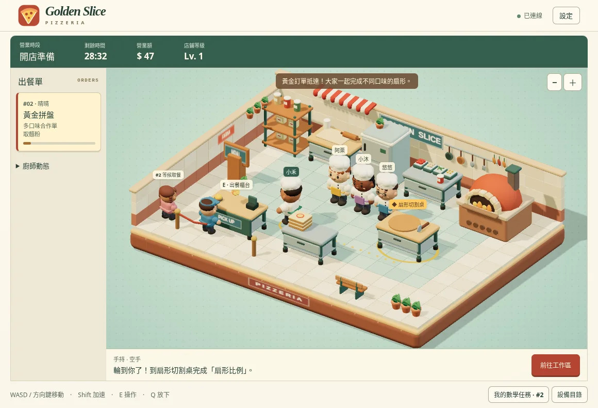
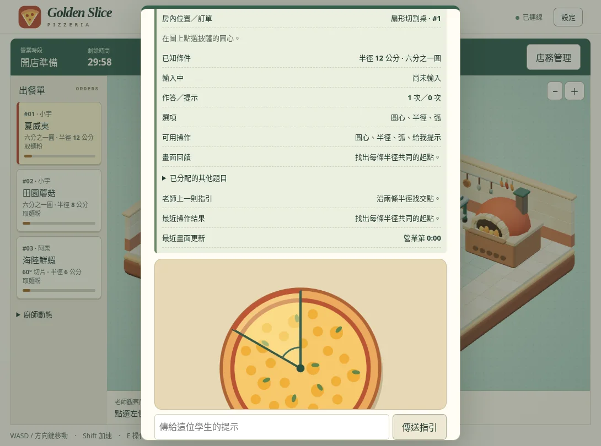
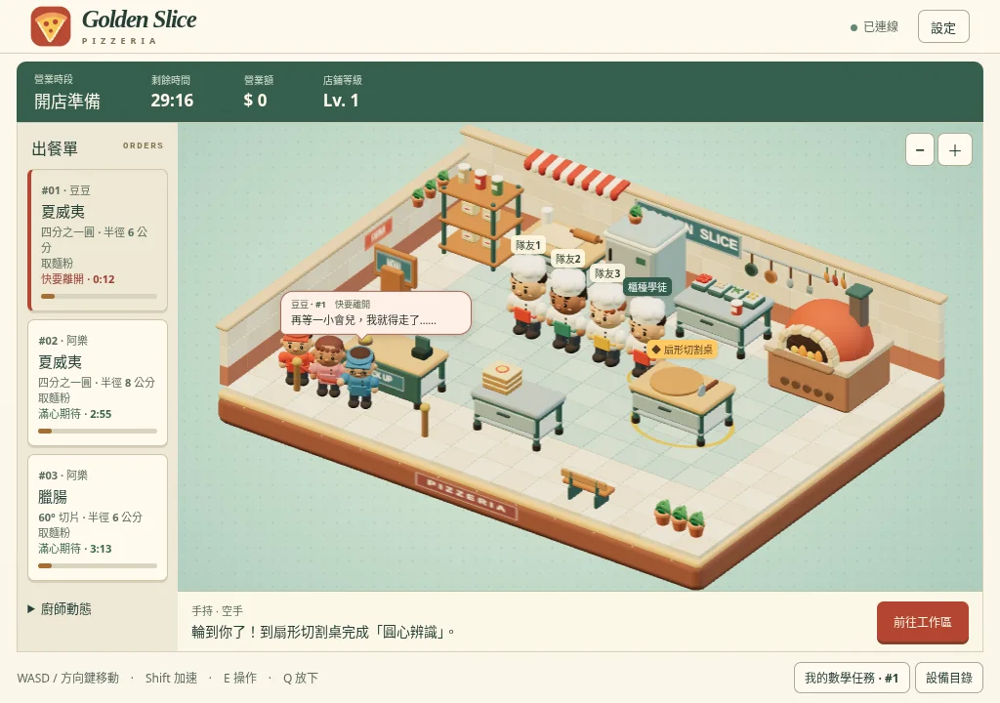
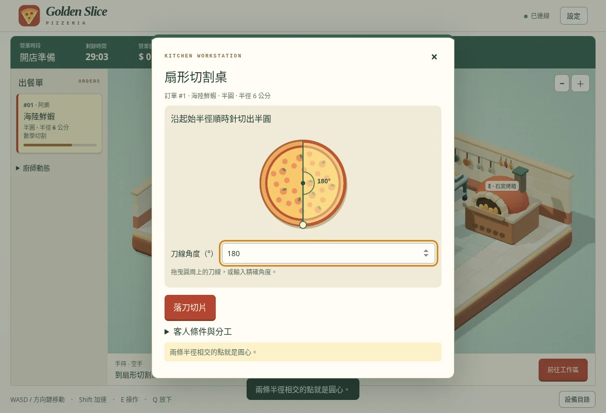
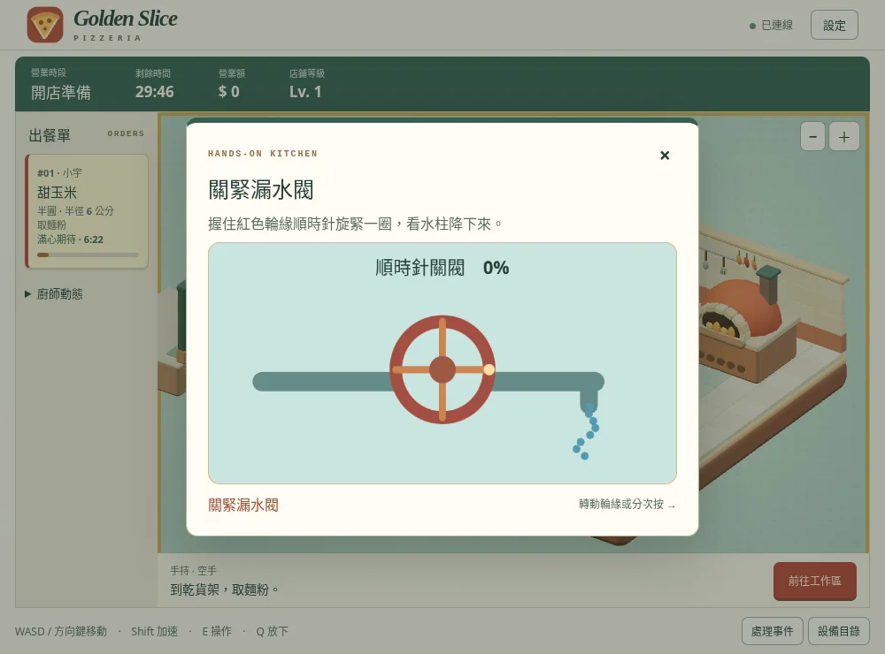

# 披薩大亨：黃金切片 · Golden Slice Pizzeria

一位老師、1～4 位學生，共同經營一間即時連線的 3D 披薩店。學生用滑鼠或鍵盤走進同一間廚房，交接食材、照看爐火，再把半徑、比例、面積與弧長用在客人的切片訂單上。介面使用繁體中文，預設營業 30 分鐘。

**[進入遊戲](https://pizza-tycoon-golden-slice.onrender.com)　·　[服務健康檢查](https://pizza-tycoon-golden-slice.onrender.com/health)**



[查看遊戲首頁畫面](docs/home.webp)

## 老師開課

1. 開啟網站，點「老師開店」與「建立房間」，將六位數房間代碼貼到課堂聊天室。
2. 學生另開網站，點「學生加入」，填代碼與暱稱、選一款廚師外觀。老師持有獨立觀察席。只要一名學生在線就可開始。
3. 在等待室調整 3～60 分鐘、題目難度、訂單速度、隨機事件與公式提示。學生的「我準備好了」方便點名。
4. 開始後，老師可從「店務管理」看目前題目、最近答案與個人進度，暫停、繼續、延長 2 分鐘、提供提示、指定事件、提早啟動黃金訂單或結束遊戲。
5. 時間到或老師提前打烊時，全班會自動進入本輪成果。學生可以點「打烊練刀」不限次練習，老師可以匯出 CSV 或按「準備下一輪」。同一房號與廚師會回到準備室，老師再按「開始營業」。準備室可重看、匯出上一輪成果；需要長期保存時請下載 CSV。

### 30 分鐘的帶課方式

| 時段 | 教師引導 |
| --- | --- |
| 0～3 分 | 各自走到一台設備；試走、拾取、放下與交接。 |
| 3～8 分 | 從指定比例的訂單認識圓心、半徑、弧與圓心角。 |
| 8～15 分 | 交換料理工作，比較不同角度，辨認半徑與直徑。 |
| 15～22 分 | 在配料與切割時練習面積、弧長、用量與反推角度。 |
| 22～約 26 分（四人場） | 接綜合單、處理事件、使用公款升級。達到營收目標後仍會出單。 |
| 最後約 3～4 分 | 優先處理黃金拼盤；時間到時保留已取得的收入與學習成果。 |

其他營業時間按比例調整時段。訂單依人數改變並行數、配料量、烘烤時間、等待耐心、事件工作量與黃金拼盤的分區。伺服器優先將新題目分給已完成題數與待辦較少的學生，落後於進度時可增加同張訂單的跨站任務。8～12 題是每人的帶課目標，實際題量取決於出餐速度。建議每完成一到兩張單，讓學生換一個位置。

## 怎麼玩

點左欄出餐單可切換訂單。下方顯示手上物品、下一步與目的地。目的地在地板上有金色路徑，點「前往工作區」會自動繞過設備。點「我的數學任務」會選取自己輪值的訂單；只有按下前往或點選設備才會開始走路。

| 工作區 | 學生實際操作 |
| --- | --- |
| 乾貨架、揉麵桌 | 按住倒麵粉，看秤上的克數，進入目標綠區時放開。把粉放上桌，調整半徑，握住擀麵棍，往返三趟揉成指定大小。 |
| 冰箱、配料桌 | 隊友可依採買單，在三格食材中依序挑出兩樣裝籃。送齊配料與餅皮後，依訂單鋪料；面積與用量題也在這裡完成。 |
| 石窯 | 可先操作溫控旋鈕預熱，再用木鏟推入生披薩；烤好後反向拉出。其他廚師做數學時，已熟的披薩會保溫。 |
| 扇形切割桌 | 放好熟披薩，輪值廚師完成本桌任務。拖曳切線或輸入角度，再從圓心沿該刀線推動滾刀，切出有厚度的扇形。 |
| 裝盒桌、出餐櫃台 | 拿起切片，折盒，再取出餐盒交給對應訂單的客人。火候、耐心、VIP 與設備影響實收。 |
| 設備目錄 | 共享公款可購買快火雙爐位、擴充冰箱、金邊餐盒與金色招牌。營業額獨立累計。 |

靠近設備後，拿起、放下、倒入配料與交餐都會直接執行。食材在廚師手邊與檯面間移動，隊友也看得到。各站的成品會留在桌上，下一位可以直接取走。也可用 Q 把物品放在腳邊，隊友再點選拾取。每件主餐及配料籃都有訂單編號。掉線時手中物品會留在地面，未完成的題目會重新分配。

走道底部會顯示常用按鍵。上方「操作說明」和工作桌右上方的同名按鈕會顯示眼前這一步的操作，鍵盤可按 **?** 開啟、Esc 返回。

**鍵盤與滑鼠**　WASD 或方向鍵移動、Shift 加速、E 或空白鍵操作附近設備、Q 放下、Esc 關閉視窗。也可點地板走路、點設備自動靠近，並用滑鼠完成所有主要操作。右上「設定」可獨立調整音樂、音效、全部靜音及低畫質。背景音樂預設為零。

## 合作接棒與手感

四人開店時，第一張訂單同時開放四個位置。第一位領粉做餅皮，第二位從冰箱搬料，第三位先轉動石窯旋鈕預熱，第四位在切割桌準備數學樣板。後面的訂單輪換建議分工。多人時可以提前完成自己的數學任務，食材仍然必須實際備妥、烤熟才可切片。

揉麵、鋪料、入爐、切片是四個主要工序。當仍有未主導過這張單的在線夥伴，下一道主工序交給其中一位。所有在線廚師都參與過後，連續兩道工序仍要換手。四人場四道工序由四位不同廚師主導，兩人場可以輪流，單人可包辦。搬運和放置可自由支援；不負責入爐的搬運者能把木鏟放在爐邊給隊友。有人掉線時馬上依目前在線名單調整。

乾貨架考手感，按住空白鍵或秤面倒粉，放開時可看秤重差距。冰箱考辨識，點食材或按 1～3 選格。揉麵、鋪料、入爐、切片與裝盒各有工具，要從起點推到終點。老師與隊友能看到廚師的操作動畫。鍵盤也可以在工具板按空白鍵抓住工具、用方向鍵移動，再按空白鍵放開。

## 老師跟看與螢幕尺寸

在「店務管理 → 學生畫面與作答」選取一位廚師，可跟看其遊戲頁面、工作桌、訂單、當前題目、未送出的答案、可用操作、回饋及最近一次操作結果。圖形題顯示對應披薩圖，手勢操作會重繪工具位置與進度。老師可以對這位學生傳送文字指引。資料只反映遊戲介面，教師與學生不需要開啟螢幕分享。

遊戲依視窗可用寬高安排固定的廚房舞台。窄直式螢幕改用上方橫向訂單列，矮橫式螢幕會壓縮工具列。長表單可在視窗內自行捲動；學生操作、隊友更新或自動開啟工作桌時，主畫面保留目前位置。



## 櫃檯的客人在說什麼

客人從左側人行道走進有招牌的門洞，依序站到櫃檯等候。付款和逾時離店都會從隊列走回門外，進出分別走門洞的兩側。對話框會輪流顯示，點客人或出餐單可以查看那位客人的對話。點單時他會說想吃什麼，烤好或裝盒後會對眼前的披薩有不同反應。每張出餐單都顯示顧客心情與剩餘候餐時間。剩一半時客人開始催單，剩 22% 時會給最後提醒。

時間歸零前交付，客人會結帳並道謝；逾時則取消訂單，失望離店，收入為 0。該單的工作、食材與餐盒會收走，其他訂單、已作答的學習紀錄及公款會保留。打烊時可查看等太久離開的客人人數。

四人場第一位一般客人等 3 分 20 秒，單人場等 6 分 35 秒。後到的客人依排隊人數增加等候時間。老師暫停時，所有人的候餐倒數一起停止；金色招牌為現場和後來的客人增加 60 秒。黃金拼盤客人的基本耐心比一般單多 70 秒。



## 數學與切割



刀線不合訂單時，披薩會留在原桌。實線是學生現在的角度，藍色虛線是這一份訂單的目標。提示會寫出差幾度、往順時針或逆時針轉；調到兩線重合後再從圓心落刀。黃金拼盤逐片判定。

全遊戲使用 π = 3.14。半徑是圓心到圓周的距離，直徑是兩倍半徑。圓心角 θ 決定切片占整張披薩的比例。

| 求什麼 | 算式 | 單位 |
| --- | --- | --- |
| 占全圓比例 | θ ÷ 360 | 比例 |
| 圓心角 | 360 × 占全圓比例 | 度 |
| 全圓面積、扇形面積 | r × r × 3.14，再乘比例得到扇形面積 | 平方公分 |
| 全圓周長、扇形弧長 | 2 × r × 3.14，再乘比例得到外側弧長 | 公分 |
| 扇形周長 | 外側弧長 ＋ 2 × r | 公分 |

例如，半徑 10 公分的四分之一圓，應切 90°，面積為 78.5 平方公分，外緣弧長為 15.7 公分。輸入比例如 1/4、2/8、0.25 均可。需近似的題目會標示精度，配料用量會提供每平方公分的克數。

題型包含圖上辨識圓心、半徑、扇形名稱／比例、圓心角、由直徑求半徑、面積、弧長、反推角度、同半徑的切片比較與配料用量。題目由幾何參數生成，口味、尺寸、角度和圖形方向會改變。答錯後可重試，提示會從觀念進到分段算式。學生的首答與重試完成分開記錄，未接觸的題型單獨標記。

## 事件、創作與黃金訂單

| 事件 | 怎麼玩 |
| --- | --- |
| 老鼠入侵 | 在走道追上老鼠，觀察三個洞口，在兩次不同的探頭時機點中牠。可按 1～3 選洞。 |
| 廚房漏水 | 走到漏水位置，握住紅色閥輪順時針轉一圈，水柱會隨之變小。也可分次按右方向鍵。 |
| 食材配送 | 根據貨單選箱，抱到冰箱，再把標籤配到正確的冷藏架。取貨區與貨架的排列不同。 |
| 烤箱故障 | 觀察三盞燈。每個開關會翻轉自己和右邊一盞燈的亮暗，把三盞燈都點亮就能修好。 |
| 主廚對決 | 看光圈碰到金環，點麵團或按空白鍵打三個不同節拍。錯過一拍可以等下一拍。 |

- **創意訂單**　在揉麵桌命名、改尺寸與角度，選口味與最多四種配料。題目依新參數重建，成功的搭配會加入招牌食譜。
- **黃金拼盤**　同一張披薩分成不同口味與比例，每位線上學生獲得數學任務。多人場為四分之一、二分之一、四分之一，單人場減為兩個半圓。每區獨立鋪料、落刀，全部交付才會出現金色慶祝與成品展示。

多人事件中的學生可以同時操作。配送可各自搬一箱，漏水與老鼠有各自的工作位置；多人救援會記錄不同參與者，學生在第一棒完成後可先支援料理。水柱、飛濺、鼠跡、送貨車、爐火電弧和麵粉飛散會出現在廚房內。事件結束後場景會恢復，連續兩次自動事件使用不同種類。



[查看漏水時的廚房全景](docs/rescue.webp)

## 本機環境

需要 Node.js 22 以上及支援 WebGL 2 的桌面瀏覽器，推薦近期 Chrome 或 Edge。

```sh
npm ci
npm test
npm start
```

開啟 <http://localhost:3000>。開發時可用不同分頁扮演老師和學生；若從已登入分頁複製出新分頁，有些瀏覽器也會複製其房間憑證，建議直接另開新分頁輸入網址。

## 系統與部署

Node HTTP 伺服器同時提供前端、Three.js 模組、`GET /health` 與 WebSocket `/play`。後端處理移動、碰撞、單位換算、答案驗證、設備占用、訂單、金流與剩餘時間。每間教室有自己的狀態。客戶端負責插補位置、程序化建模、聲音與提示。老師的答案紀錄與其他學生的個人統計不會包含在學生收到的狀態中。

| 檔案 | 職責 |
| --- | --- |
| server.js、game.js | 靜態入口、WebSocket、房間憑證、斷線重連、權威遊戲規則 |
| math.js | 數學生成、等值表示、精度、分級提示 |
| public/world.js | 設備位置、走道與尋路、外觀資料 |
| public/models.js、scene.js | 3D 幾何、人物動畫、烘烤與交付特效、鏡頭與互動 |
| public/app.js、workbench.js | 學生與老師的操作介面、切割盤、學習回饋與合成音效 |
| public/brigade.js、gestures.js | 接棒資格、站位分工與伺服器共用的手勢判定 |
| public/operation.js、eventfx.js | 揉麵、落刀等料理工具與全場事件特效 |
| public/activities.js、arcade.js | 食材與五種救援小遊戲的規則驗證、畫面、滑鼠與鍵盤輸入 |
| public/guests.js | 候餐對話、排隊位置與進出門動線 |
| test/ | 邏輯、多人連線與瀏覽器端到端測試 |

正式站使用單一 Render Free Web Service。根目錄的 `render.yaml` 設定 Node、`npm ci --omit=dev`、`npm start`、`/health` 與手動部署。服務綁定 `0.0.0.0` 並讀取 Render 的 `PORT`。更新現有服務時，先確認沒有上課中的房間，再從服務頁面手動部署最新的 main。若要重建，可從 [Blueprint 部署入口](https://dashboard.render.com/blueprint/new?repo=https://github.com/Chuang-Chih-Hao/Pizza-Tycoon) 讀取相同設定。

**課堂注意事項**　免費服務閒置後可能需要冷啟動，建議先開站確認。房間與統計保存在單一執行個體的記憶體中；重啟、重新部署或服務休眠後可能失去該場資料。同一分頁重新整理會嘗試恢復原身分。多人授課須連到同一個服務網址。3D 場景需要 WebGL 2，低畫質會降低繪製頻率並關閉陰影。實際上課題量與完成黃金訂單所需時間，仍需依學生熟悉度調整。

## 測試紀錄

- Node 自動化測試涵蓋 10 類數學題 × 6 種扇形比例 × 4 種半徑，包括 240°、270°、帶單位的計算與等值分數。
- 1、2、3、4 人各自模擬從取麵粉到領收入，並完成各自人數的黃金拼盤；另測 30 分鐘模擬時鐘、未完訂單結算、重試、保溫、配方重算、金流與事件。
- 一位老師與四條獨立學生 WebSocket 同時測試移動廣播、搶取同一袋食材、掉落、重連、重複操作、房間隔離與結束。
- Chromium 自動操作測試實際點擊加入、走到工作桌、備料、入爐、作答、切割、交付與查看成果。另量測 60°、90°、180°、240°、270° 切片模型的三角面積比，並在 1366×768、390×844 與 844×390 三種尺寸核對操作區可見及頁面捲動位置。老師與學生兩個瀏覽器另驗證即時題目、錯答回饋、私人指引、暫停與結算。README 的畫面取自執行中的遊戲。
- 可重跑的瀏覽器測試需要 Python、Playwright 與 websockets，先啟動本機服務，再執行下方指令。可用 `PIZZA_BROWSER` 指定已有的 Chromium。測試建立獨立房間。

```sh
python -m pip install playwright "websockets>=15"
python -m playwright install chromium
python test/browser_flow.py --url http://127.0.0.1:3000
python test/observer_flow.py --url http://127.0.0.1:3000
python test/customer_flow.py --url http://127.0.0.1:3000
python test/rescue_flow.py --url http://127.0.0.1:3000
```

救援測試使用遊戲的 3D 牆面與門框模型檢查五個隊位的進出路徑，並透過課堂介面完成五種事件。

顧客測試以四位學生開房，核對選客、窄螢幕對話框、最後提醒、逾時消單與零收入。此腳本在一般設定會實際等到第一位客人的 200 秒期限。

上述是自動化測試紀錄。尚未進行四位真實六年級學生的 30 分鐘課堂試教，沒有 Edge 或特定學校電腦的效能實測資料。

## 版本紀錄

**1.4.0 — 門口動線、切片校正與五種救援玩法**

- 打烊自動顯示成果，可繼續練刀或由老師帶全班在原房號開下一輪。
- 常用按鍵直接放在走道與操作區，各工作桌可隨時叫出對應說明。
- 重建側門、戶外步道與排隊動線。
- 切錯時保留披薩、顯示目標刀線與角度差，調整時即時更新。
- 搬運改為即時交接動畫，取料新增秤重與按單裝籃。
- 五種事件分別考驗反應、轉動、分貨、電路推理與節奏。老師跟看可看到學生目前的救援畫面。

**1.3.0 — 顧客對話與候餐離店**

- 新增跟隨顧客的對話框、揮手、看時間、低頭離店及取餐回應。可在櫃檯或訂單上選取想聽的客人。
- 候餐倒數由伺服器同步。逾時取消與成功付款只會發生一次，結算新增離店人數。

**1.2.1 — 保留老師指引與作答草稿**

老師的私人指引會固定出現在學生的遊戲面板頂端。隊友備料或同桌狀態更新時，學生輸入中的答案與游標位置會保留。

**1.2.0 — 合作接棒、工具操作與現場跟看**

- 同單平行開放四項工作，依在線人數檢查四道主工序的不同參與者。爐邊可以交棒，離線會釋放工作。
- 食材、切刀、木鏟、盒蓋、設備升級與五種事件改用可拖動工具。校驗路徑後才會消耗材料或推進訂單，並提供鍵盤操作。
- 多人事件獨立計算各人進度，配送可並行。新增事件模型、粒子與限時提示，四人黃金挑戰預留約四分鐘。
- 新增老師跟看遊戲頁面、解題草稿、工具操作及私人指引。遊戲舞台、訂單列與面板依視窗大小調整，工作與答題過程不會捲動整頁。

**1.1.0 — 可遊玩的合作廚房**

- 加入可走動的等距廚房、九個設備與顧客區、六款廚師外觀、碰撞與點選尋路。手持物、地面掉落、桌上的成品和其他人的操作會同步。
- 串接領粉、揉麵、收配料、鋪料、烘烤、切割、裝盒及交付；加入個人任務輪替、分級提示、反推角度與大於半圓的幾何切片。
- 加入五種可操作事件、處理速度與人數調整、共享設備升級、自由創作、VIP 及最終多口味拼盤。
- 新增老師控制台、學習時保溫、個別首答與重試紀錄、CSV、課堂中斷重連與結算展示。

**1.0.0 — 可部署的連線大廳**

- 建立 Render 設定、健康檢查、六位數房號、獨立教師身分、學生加入及準備狀態。初版提供連線驗證入口。

## 資源授權

Three.js（包含 RoundedBoxGeometry、BufferGeometryUtils）與 ws 採 MIT 授權。安裝後可在各自 npm 套件內查看授權文字。廚房、廚師、披薩、事件模型、介面圖示及 Web Audio 旋律由本專案程式產生。參考圖片用作美術方向，遊戲透過即時 WebGL 繪製場景。
